# Arquitectura del sistema

Asistente académico para estudiantes de Ingeniería de Sistemas de la UNAB. Lo orquesta n8n Cloud, con agentes de IA sobre Gemini, un
servidor MCP en AWS EC2, Supabase (PostgreSQL con pgvector), Google Sheets, un scraper de noticias y una app Android propia.

> Los datos de estudiantes, matrículas, notas, NRC, requisitos y prerrequisitos son **sintéticos**. El plan de estudios (151 créditos),
> los documentos del RAG, los profesores, el calendario y las noticias provienen de fuentes oficiales y guardan su URL.

## 1. Componentes y flujo de datos

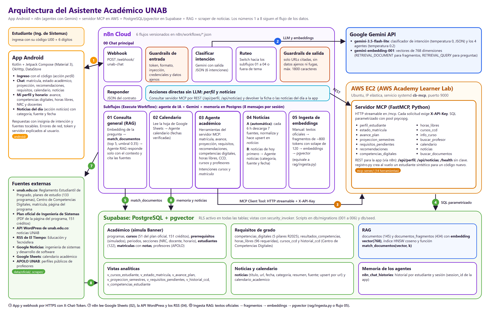

| # | Flujo de datos | Protocolo y seguridad |
|---|---|---|
| 1 | App Android y webhook del flujo 00 | HTTPS, `X-Chat-Token` |
| 2 | n8n y Gemini (clasificador, agentes, embeddings) | HTTPS, credencial de n8n |
| 3 | Agente del flujo 03 y servidor MCP | MCP sobre HTTP streamable, `X-API-Key` |
| 4 | Servidor MCP y Supabase | PostgreSQL con SSL (pooler), SQL parametrizado |
| 5 | Subflujo 01 y pgvector | `match_documentos(vector, 5)` |
| 6 | Memoria de los agentes y noticias | Postgres Chat Memory y upsert en `noticias` |
| 7 | n8n y fuentes externas | Google Sheets (02), API WordPress y RSS (04) |
| 8 | Ingesta del RAG | `rag/ingesta.py` o flujo 05: textos oficiales, fragmentos, embeddings, pgvector |

## 2. Secuencia de una pregunta

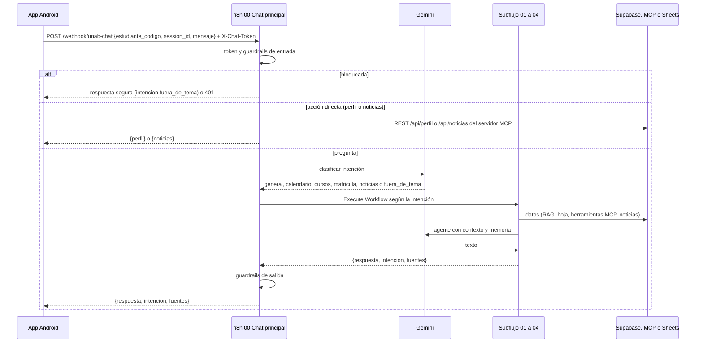

## 3. Ruteo por intención

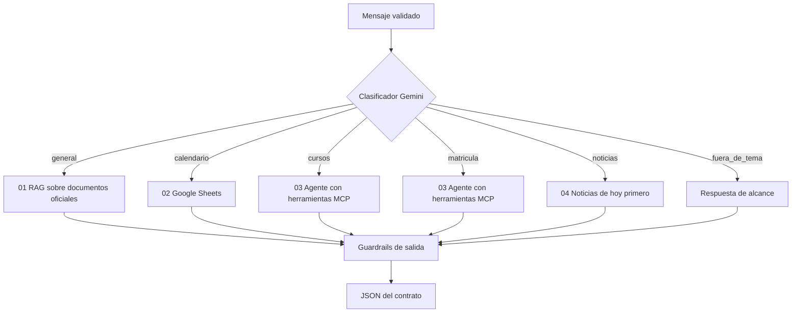

Si el clasificador falla o devuelve una etiqueta no válida, se usa `general` (RAG). Si un subflujo falla (por ejemplo por el límite de
la API de Gemini), el flujo 00 continúa y el guardrail de salida devuelve un mensaje claro en lugar de un error.

## 4. Flujos de n8n

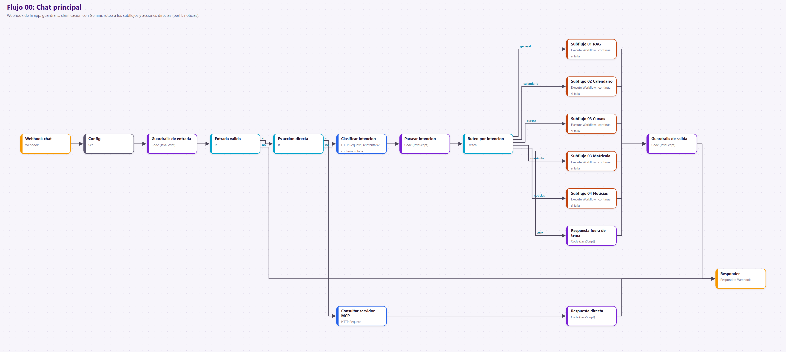

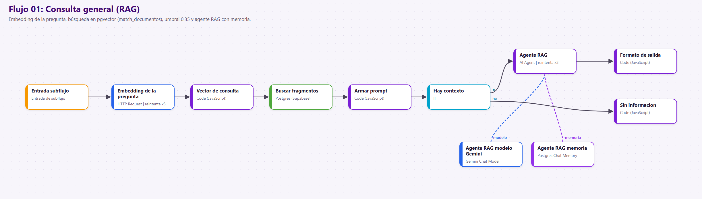

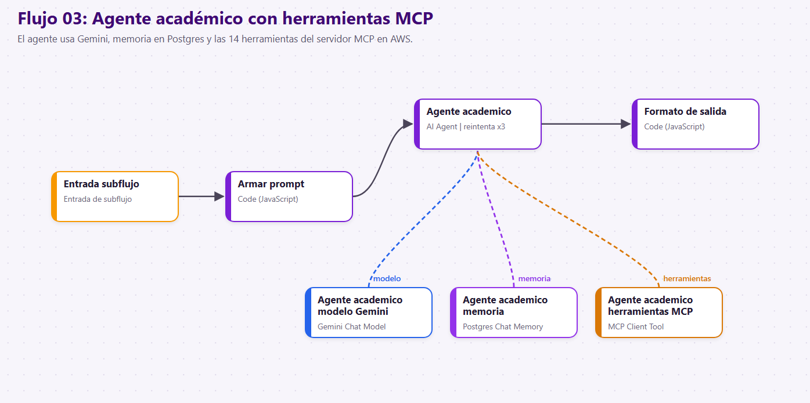

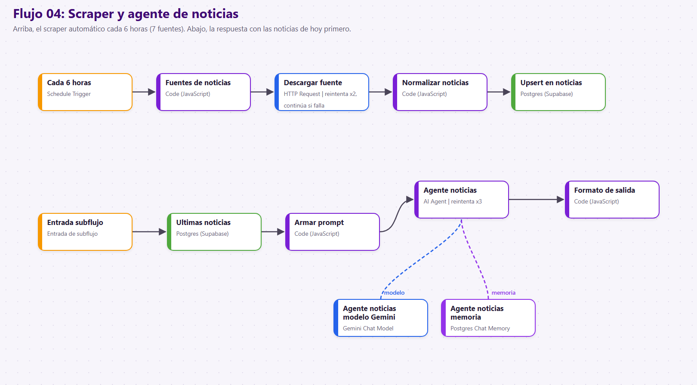

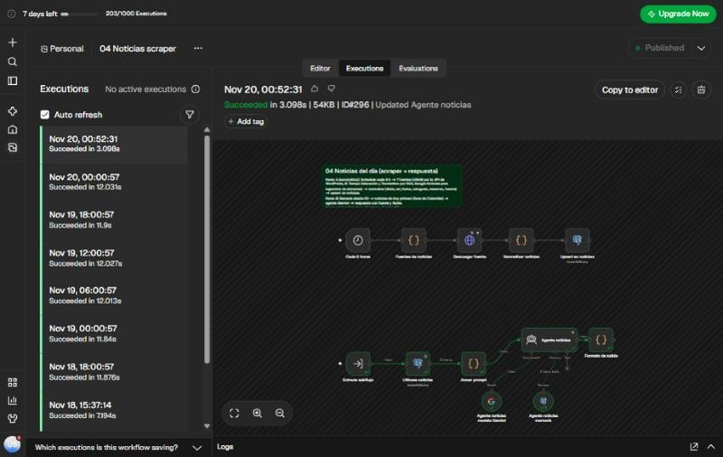

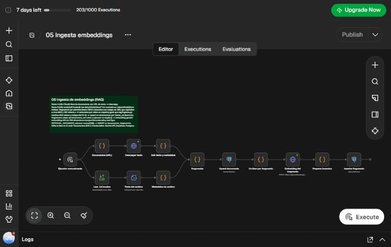

Estos diagramas muestran los nodos y las conexiones de los JSON de `n8n/workflows/`; las versiones interactivas están en `docs/diagramas/*.html`.

## 5. Modelo de datos y RAG

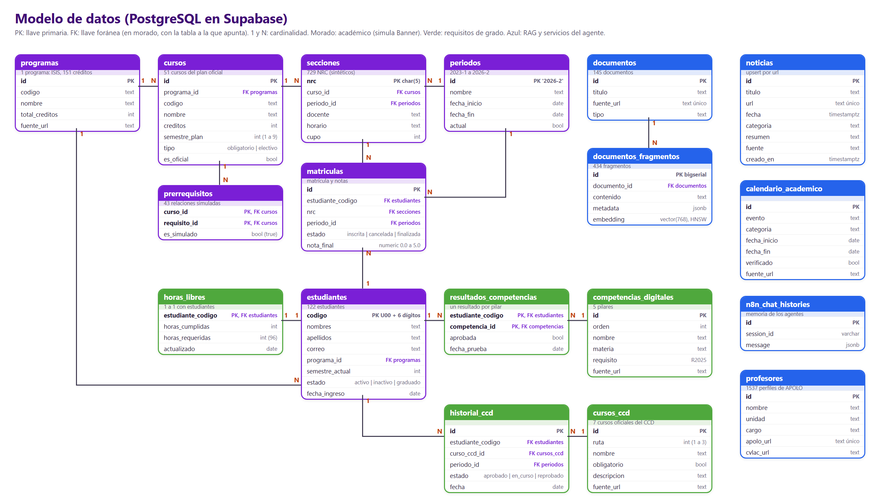

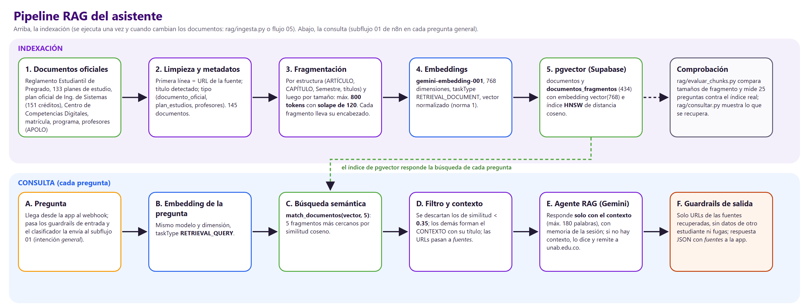

## 6. Despliegue

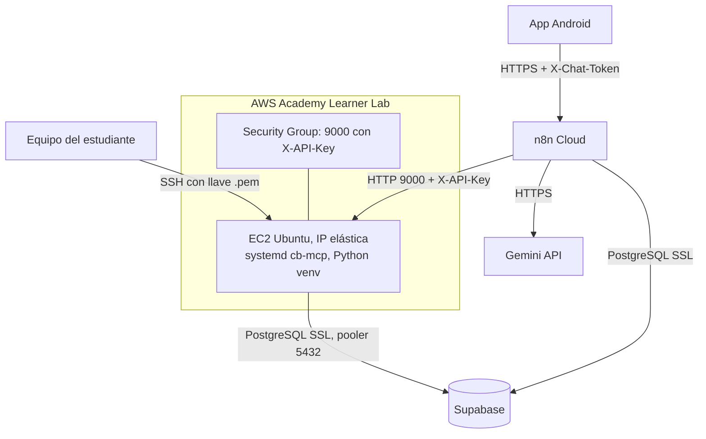

## 7. Decisiones de diseño

| Decisión | Motivo |
|---|---|
| Subflujos con *Execute Workflow* | Cada capacidad (RAG, calendario, agente académico, noticias) se prueba y se demuestra por separado |
| Clasificador con salida JSON restringida | Una llamada barata y determinística decide el camino; el fallo cae en RAG |
| Servidor MCP para los datos del estudiante | Las consultas SQL quedan fuera de n8n, en herramientas de consulta (la única escritura es el alta automática de un estudiante sintético), validadas y con pruebas; cualquier cliente MCP puede usar el mismo servidor |
| Endpoints REST en el mismo servidor (`/api/perfil`, `/api/noticias`) | La app obtiene su ficha y las noticias sin pasar por el LLM: rápido y sin costo |
| Guardrails en código (nodos Code) | Reglas determinísticas y auditables, sin gastar llamadas al LLM |
| Fuentes calculadas por el flujo | El modelo no puede inventar enlaces; el guardrail de salida quita cualquier URL ajena |
| Memoria con clave `codigo:session_id` | Persistente entre sesiones y aislada por estudiante |
| Supabase con pgvector e índice HNSW | Datos relacionales, vectores y memoria en una sola base gratuita |
| Embeddings de 768 dimensiones, fragmentos de 800 tokens con solape de 120 | Justificado con el experimento de `docs/rag.md` |
| Plan oficial de 151 créditos en la base y en el RAG | El avance calculado y el plan citado coinciden |
| JSON de los flujos como fuente de verdad | se importan en n8n con *Import from File* y se publican; el repositorio refleja lo desplegado |
| Reintentos en los agentes y subflujos que continúan si fallan | El plan gratuito de Gemini limita las llamadas por minuto; el estudiante recibe una respuesta o un mensaje claro |
| EC2 con IP elástica y systemd | El laboratorio de AWS Academy apaga la instancia; la dirección no cambia y el servicio vuelve solo |
