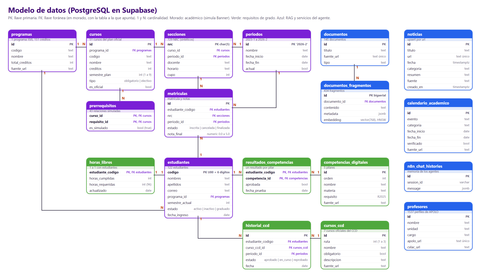

# Documentación técnica

Asistente académico con n8n para estudiantes de Ingeniería de Sistemas de la UNAB (curso Ciencia de Datos). El contrato de interfaces
entre componentes está en [`CONTRATO.md`](CONTRATO.md), la arquitectura en [`arquitectura.md`](arquitectura.md) y el RAG en
[`rag.md`](rag.md). Los valores numéricos y su justificación están en [`parametros.md`](parametros.md) y la verificación del 2026-11-20 en [`pruebas.md`](pruebas.md).

## 1. Componentes

| Carpeta | Componente | Tecnología |
|---|---|---|
| `db/` | Modelo que simula Banner-Cosmos, vistas, `match_documentos`, seed sintético | Supabase PostgreSQL 17 + pgvector |
| `rag/` | Ingesta, consulta y evaluación del RAG | Python + Gemini |
| `mcp-server/` | 14 herramientas MCP de consulta y 2 endpoints REST | Python, FastMCP, HTTP streamable `:9000/mcp` |
| `n8n/workflows/` | Orquestación (6 flujos) y agentes | n8n Cloud, AI Agent, Gemini |
| `scraper/` | Scraper de noticias del día (misma lógica del flujo 04) | Python, requests, psycopg 3 |
| `infra/` | Servicio systemd, Security Groups, guías de Supabase, n8n y Sheets | Ubuntu, systemd |
| `android/` | App móvil | Kotlin, Jetpack Compose, OkHttp |

## 2. Modelo de datos

| Grupo | Tablas | Filas en la base viva (2026-11-20) |
|---|---|---|
| Plan de estudios | `programas`, `cursos` (51 del plan oficial, 151 créditos), `prerrequisitos` (43, `es_simulado`), `periodos` (2023-1 a 2026-2) | 1, 51, 43, 8 |
| Oferta | `secciones` (NRC de 5 dígitos, docente, horario, cupo), `profesores` (APOLO) | 729, 1537 |
| Estudiantes | `estudiantes` (código `U00` + 6 dígitos), `matriculas` (estado y nota de 0.0 a 5.0) | 122, 3359 |
| Requisitos de grado | `competencias_digitales` (5 pilares R2025), `resultados_competencias`, `horas_libres`, `cursos_ccd`, `historial_ccd` | 5, 610, 122, 7, 203 |
| Contenido | `calendario_academico`, `noticias`, `documentos`, `documentos_fragmentos` (`embedding vector(768)`, índice HNSW coseno) | 11, 86, 145, 434 |
| Memoria | `n8n_chat_histories(session_id, message jsonb)` | 192 (crece con el uso) |

Las cifras de la tabla son las de la base de Supabase en uso, leídas con `db/ver_tablas.py` el 2026-11-20 (resultado en [`pruebas.md`](pruebas.md)).
No coinciden con lo que genera el seed solo: el seed produce **120 estudiantes**, 3280 matrículas (2559 finalizadas, 633 inscritas y 88 canceladas), 600 resultados de competencias, 120 filas de horas libres y 200 de historial del CCD. La base viva suma 2 estudiantes fijos que se crean al cargar (`U00179643` y `U00179961`) y los estudiantes sintéticos que el servidor crea cuando llega un código nuevo; las noticias crecen con cada corrida del scraper (cada 6 horas) y `scraper/muestra_noticias.json` es solo una muestra de un día.

Regla de aprobación: `nota_final >= 3.0` en una matrícula `finalizada`. Los periodos usan el formato `AAAA-S` y solo uno es `actual`.

### Vistas

| Vista | Qué responde |
|---|---|
| `v_cursos_estudiante` | Estado de cada curso del plan para cada estudiante (aprobado, en curso, reprobado, pendiente) |
| `v_estado_matricula` | Cursos inscritos en el periodo actual con NRC, profesor y horario |
| `v_avance_plan` | Créditos aprobados y totales, porcentaje y semestre real |
| `v_proyeccion_semestres` | Estimación gruesa de semestres restantes (la exacta la calcula `proyeccion_semestres`) |
| `v_requisitos_pendientes` | Prerrequisitos sin cumplir de cursos no aprobados |
| `v_historial_ccd` | Cursos del Centro de Competencias Digitales por estudiante |
| `v_competencias_estudiante` | Resultado de la prueba por pilar |

Todas tienen `security_invoker = true` (migraciones 005 y 006) y las 18 tablas tienen Row Level Security.

### Función vectorial

`match_documentos(query_embedding vector(768), match_count int default 5)` devuelve `(id, documento_id, titulo, fuente_url,
contenido, similitud)` ordenado por similitud coseno.

### Datos sintéticos

`db/seed/estudiantes_base.csv` fija los 120 estudiantes (código, nombre, perfil, periodo de ingreso y de retiro). `generar_datos.py`
simula cada periodo: elige cursos elegibles por prerrequisitos (primero los reprobados y los de semestres anteriores) hasta la carga del
perfil, asigna NRC sin exceder cupos, saca la nota de una normal según el perfil y aplica cancelaciones. Los códigos nuevos que llegan
al servidor se crean con las mismas reglas (`mcp-server/app/registro.py`) y una semilla en el código, así que siempre salen iguales.

## 3. Flujos de n8n

| Archivo | Disparador | Función |
|---|---|---|
| `00_chat_principal.json` | Webhook `POST /webhook/unab-chat` | Token, guardrails, acciones directas, clasificación, ruteo, guardrails de salida |
| `01_consulta_general_rag.json` | Execute Workflow | Embedding, `match_documentos`, umbral 0.35, agente RAG |
| `02_calendario.json` | Execute Workflow | Google Sheets y agente de calendario |
| `03_cursos_realizados.json` | Execute Workflow | Agente académico con 11 herramientas MCP |
| `04_noticias_scraper.json` | Cada 6 horas y Execute Workflow | Scraper de 7 fuentes y agente de noticias |
| `05_ingesta_embeddings.json` | Manual | Fragmentar, embeddings, insertar en pgvector |

Los subflujos reciben `estudiante_codigo`, `session_id`, `mensaje`, `intencion`, `memory_key`, `mcp_url` y `google_sheet_id`, y
devuelven `{respuesta, intencion, fuentes}`. Los agentes usan `gemini-3.5-flash-lite` (temperatura 0.2), *Postgres Chat Memory* con
ventana de 8 mensajes y reintentan 3 veces si la API falla. Los prompts completos están en [`prompts.md`](prompts.md).

Credenciales de n8n: `Gemini API`, `Supabase Postgres` (SSL con el certificado raíz de Supabase), `Google Sheets` y `MCP API Key`
(Header Auth). Ningún JSON contiene secretos: el nodo *Config* del flujo 00 trae valores de reemplazo.

### Acciones directas

Con `{"accion": "perfil"}` o `{"accion": "noticias"}` el flujo 00 no usa el LLM: el nodo *Consultar servidor MCP* llama
`POST {MCP_URL}/api/{accion}` con la `X-API-Key` y *Respuesta directa* devuelve `{perfil}` o `{noticias}` a la app.

## 4. Guardrails

**Entrada** (nodo *Guardrails de entrada*, antes de cualquier LLM):
1. `X-Chat-Token` igual a `CHAT_TOKEN`; si no, HTTP 401.
2. Formato: `estudiante_codigo` con `^U00[0-9]{6}$`, `session_id` y `mensaje` presentes; mensaje de máximo 1000 caracteres.
3. Inyección de prompt: patrones en español e inglés (ignorar instrucciones, revelar el prompt, cambiar de rol, etiquetas `<system>`).
4. Pedidos de contraseñas, claves, tokens o variables de entorno.
5. Datos de otros estudiantes: otro código `U00xxxxxx` o frases como "notas de mi compañero".
6. Fuera de tema: lo detecta el clasificador y se responde con un mensaje de alcance.

**Salida** (nodo *Guardrails de salida*):
1. Solo URLs que estén en `fuentes`; las demás se reemplazan por "(enlace omitido)".
2. Si la respuesta menciona otro código de estudiante, se reemplaza por una respuesta segura.
3. Detección de fugas (instrucciones internas, `X-API-Key`, patrones de clave).
4. Límite de 1800 caracteres y respuesta de respaldo si queda vacía o si el subflujo falló.

Además, el agente recibe el código del solicitante en sus instrucciones y la memoria se separa por `codigo:session_id`.

## 5. Memoria persistente

*Postgres Chat Memory* guarda la conversación en `n8n_chat_histories` con `memory_key = estudiante_codigo:session_id` y ventana de 8
mensajes. La app conserva su `session_id`, así que al reabrirla el asistente recuerda el contexto. El clasificador de intención mira solo
el mensaje actual.

## 6. RAG

Resumen (detalle y experimento en [`rag.md`](rag.md)): 145 documentos y 434 fragmentos construidos con `rag/ingesta.py`; fragmentación por estructura con máximo 800
tokens y solape de 120 (el flujo 05 de n8n usa límites equivalentes, 3200 y 480 caracteres, para agregar o refrescar documentos); `gemini-embedding-001` de 768 dimensiones; `match_documentos` con k = 5 y umbral 0.35; el agente responde solo
con el contexto y el flujo adjunta las fuentes.

## 7. Servidor MCP

Escucha en `0.0.0.0:9000/mcp` (HTTP streamable) y exige `X-API-Key` en todo excepto `GET /health`. Herramientas (JSON):
`perfil_estudiante`, `estado_matricula`, `avance_plan`, `proyeccion_semestres`, `requisitos_pendientes`, `recomendaciones`,
`competencias_digitales`, `horas_libres`, `cursos_ccd`, `info_curso`, `buscar_profesor`, `calendario`, `noticias` y
`buscar_documentos`. Son consultas; la única escritura es el alta automática de un estudiante sintético cuando llega un código válido que no existe. Endpoints REST: `POST /api/perfil` y `POST /api/noticias`.

La lógica de negocio está en `app/logica.py` (avance, semestre real, brecha de créditos, proyección con prerrequisitos y tope de
créditos, alertas, recomendaciones, competencias y horas libres) y se prueba sin base de datos. Para conectarlo desde otro cliente MCP
basta la URL `http://IP_PUBLICA_EC2:9000/mcp` con el encabezado `X-API-Key`; para inspeccionarlo:
`npx @modelcontextprotocol/inspector`.

## 8. Scraper de noticias

El flujo 04 (y `scraper/scraper_noticias.py`) recoge 7 fuentes: 4 categorías de la API de WordPress de unab.edu.co, El Tiempo Educación y
Tecnósfera (RSS) y Google Noticias para "ingeniería de sistemas" o "desarrollo de software" (RSS de búsqueda, última semana, se guarda el
medio que publicó). Limpia el HTML, normaliza la fecha a ISO con zona, deduplica por URL y hace upsert en `noticias` cada 6 horas. Las
consultas marcan `es_hoy` con la fecha de Colombia y ponen primero las de hoy.

## 9. Herramientas del proyecto

| Script | Para qué |
|---|---|
| `db/seed/generar_datos.py`, `db/seed/cargar.py` | Generar y cargar los datos (con `--migrar`, `--regenerar` o `--requisitos`) |
| `db/ver_tablas.py` | Conectarse a la base y mostrar las tablas con datos |
| `rag/ingesta.py`, `rag/consultar.py`, `rag/evaluar_chunks.py`, `rag/evaluar_umbral.py` | Indexar, consultar y evaluar el RAG (tamaño de fragmento y umbral de similitud) |
| `infra/probar_mcp.py` | Llamar las herramientas del servidor MCP desplegado |
| `n8n/herramientas/probar_webhook.py` | Probar el webhook como la app (`CODIGO\|pregunta`, `@perfil`, `@noticias`) |
| `scraper/scraper_noticias.py` | Scraper desde la terminal (`--hoy`, `--json`) |
| `docs/diagramas/*.html` | Diagramas de arquitectura, datos, RAG y flujos |

## 10. Pruebas

| Qué | Cómo | Resultado |
|---|---|---|
| Servidor MCP | `cd mcp-server && TEST_DATABASE_URL=$DATABASE_URL python -m pytest` | 43 pruebas: 37 pasan sin base y 6 de integración (se omiten sin `TEST_DATABASE_URL`) |
| RAG | `python -m pytest -q rag/tests`, `python rag/evaluar_chunks.py` | 3 pruebas; 25 preguntas con acierto@1 = 1.00 |
| App | `cd android && ./gradlew testDebugUnitTest` | 48 pruebas |
| Webhook | `python n8n/herramientas/probar_webhook.py "U00179961\|¿Cómo voy en mi plan de estudios?"` | Respuesta de producción |
| Postman | `docs/postman/Asistente_UNAB.postman_collection.json` | 12 peticiones con pruebas |
| Guardrails | Inyección, datos ajenos, fuera de tema y token inválido (`docs/capturas/16_guardrails.png`) | Bloqueados; 401 sin token |
| Ejecución en n8n | Pestaña **Executions** de n8n | Nodos en orden con estado y tiempo |

## 11. Seguridad y datos

- Sin claves en el repositorio: `.env` local (plantilla en `.env.example`), credenciales en n8n.
- Security Group: el 9000 está abierto a internet y se protege con `X-API-Key` obligatoria; la instancia es compartida y tiene otros puertos abiertos por otros proyectos (ver `infra/SECURITY_GROUPS.md`, con los riesgos y el endurecimiento recomendado).
- APK: la URL del webhook y el token que estén en `android/local.properties` quedan dentro del APK; cada persona compila el suyo y nunca se publica un APK hecho con valores reales.
- Datos de estudiantes sintéticos (correos `@demo.unab.local`); datos oficiales con su URL; prerrequisitos simulados marcados.
