# Manual de usuario: Asistente Académico UNAB

El Asistente Académico UNAB es una app Android para estudiantes de Ingeniería de Sistemas. Con tu código de estudiante puedes
preguntarle por tu matrícula, cómo vas en el plan de estudios, cuántos semestres te faltan, qué cursos te conviene inscribir, tus
requisitos de grado (competencias digitales y horas libres), el reglamento, el calendario académico y las noticias del día.

> Los datos académicos de la demostración son sintéticos: no corresponden a personas reales ni a la plataforma oficial de la UNAB.

## 1. Instalar la app

1. Compila el archivo `app-debug.apk` con `./gradlew assembleDebug` en la carpeta `android/` (con tu propio `local.properties`) o abre el
   proyecto en Android Studio y pulsa **Run**. No instales APK descargados de fuentes desconocidas: un APK compilado con la URL y el token
   del administrador los lleva dentro, por eso el administrador no lo publica y te entrega esos valores por separado.
2. En el teléfono, permite la instalación desde esta fuente si Android lo pide.
3. Necesitas Android 8.0 o superior y conexión a internet.

## 2. Configurar el webhook (solo la primera vez)

En la pantalla de ingreso, toca **Ajustes del webhook** (abajo) y escribe:

| Campo | Qué poner |
|---|---|
| URL del webhook | La que te entregue el administrador, por ejemplo `https://SU-INSTANCIA.app.n8n.cloud/webhook/unab-chat` |
| Token del chat | El `CHAT_TOKEN` que te entregue el administrador |

Pulsa **Guardar**. En Ajustes también puedes activar el tema oscuro.

## 3. Ingresar

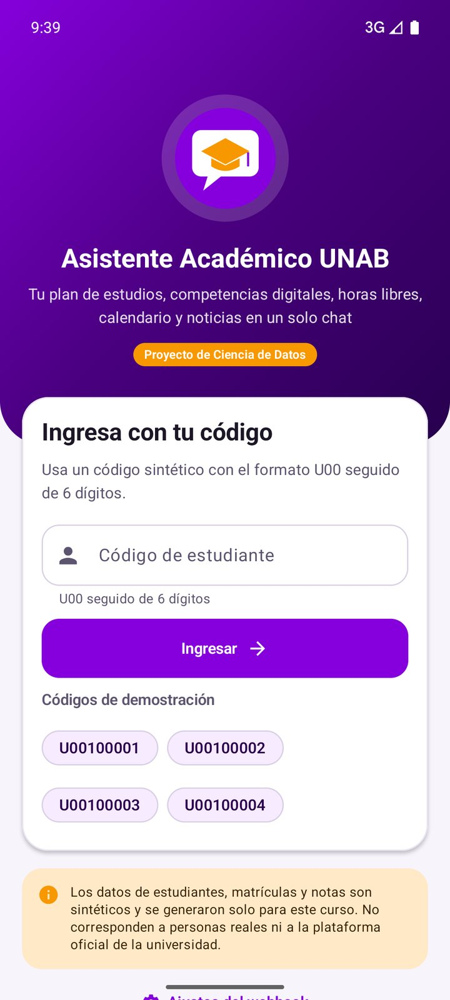

1. Escribe tu código de estudiante: `U00` seguido de 6 dígitos (por ejemplo `U00100001`), o toca uno de los **códigos de demostración**.
2. Pulsa **Ingresar**. La app valida el código con el servidor y abre el chat con tu nombre.
3. Si aparece un error, la app explica la causa: código con formato inválido, token incorrecto (revisa Ajustes) o sin conexión.

La sesión queda guardada: al volver a abrir la app entras directo al chat.

## 4. Inicio del chat

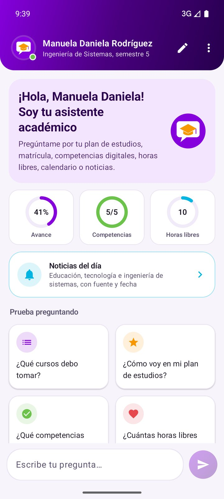

- Arriba ves tu nombre, programa y semestre. Tócalo para abrir **Mi perfil y horario**.
- Tres indicadores: **avance** del plan, **competencias digitales** aprobadas (de 5) y **horas libres** (de 96).
- **Noticias del día**: abre la pantalla de noticias.
- **Prueba preguntando**: tarjetas con preguntas frecuentes. Tócalas para enviarlas.
- Abajo escribes tu pregunta y pulsas el botón de enviar.
- El botón del lápiz (Nueva conversación) borra la conversación en pantalla y hace que el asistente olvide lo hablado; si ya hay mensajes pide confirmación (Empezar o Cancelar) y al terminar muestra el aviso "Nueva conversación iniciada". Úsalo cuando cambies de tema o quieras empezar de cero. La conversación se conserva al cerrar y abrir la app hasta que la reinicies. El menú de tres puntos tiene Mi perfil y horario, Noticias del día
  y Ajustes.

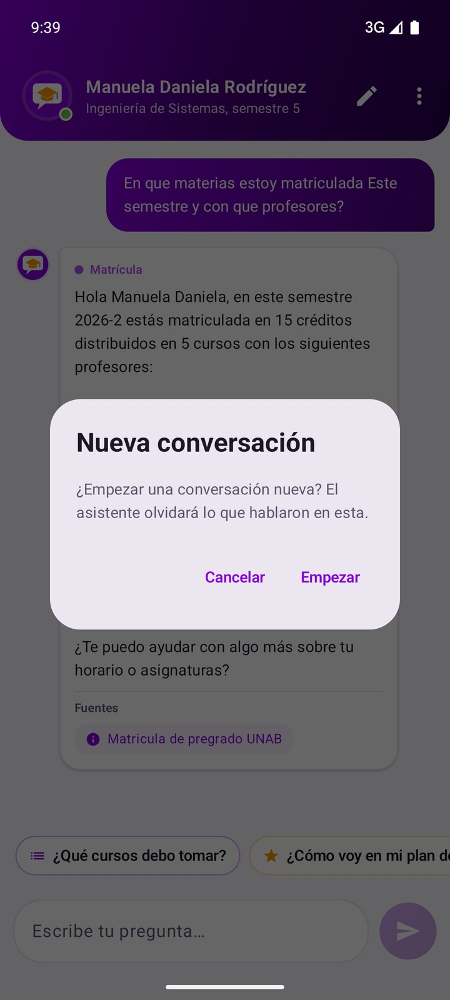

## 5. Qué puedes preguntar

| Quieres saber | Pregunta de ejemplo | Ejemplo |
|---|---|---|
| Tu matrícula | ¿En qué materias estoy matriculada y con qué profesores? | 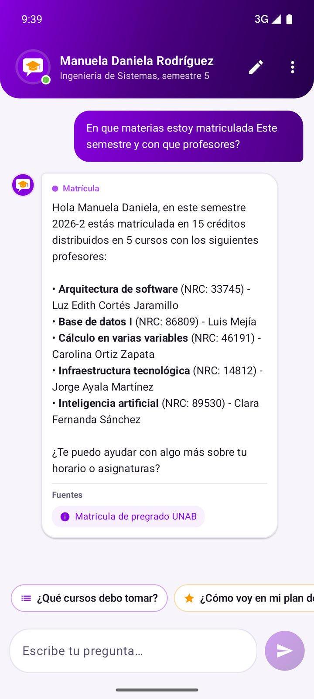 |
| Tu estado académico | ¿Cómo voy en mi plan de estudios? | 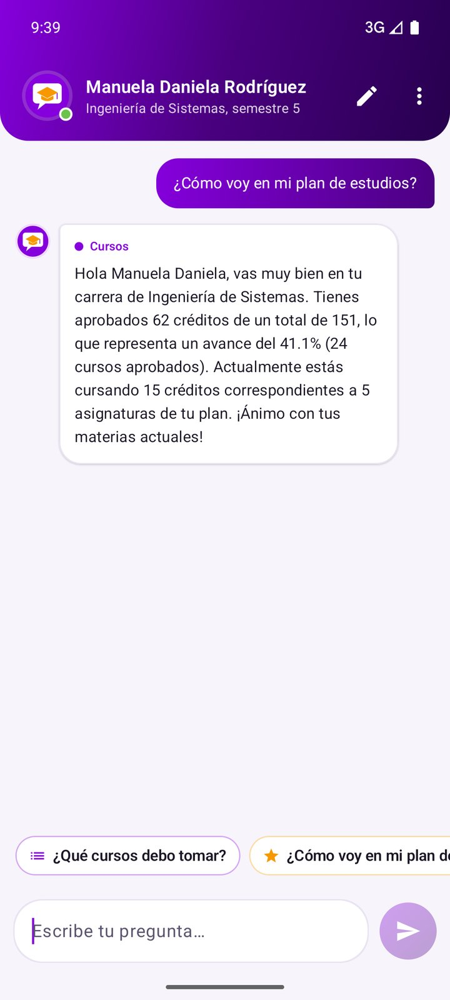 |
| Tu proyección | ¿Cuántos semestres me faltan? | 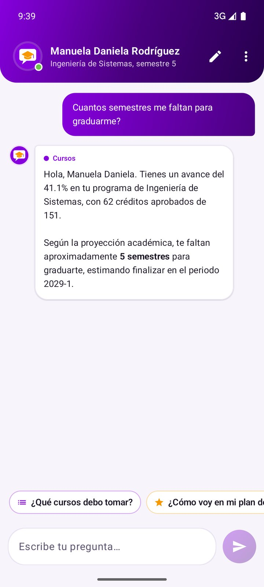 |
| Qué inscribir | ¿Qué cursos debo tomar? | 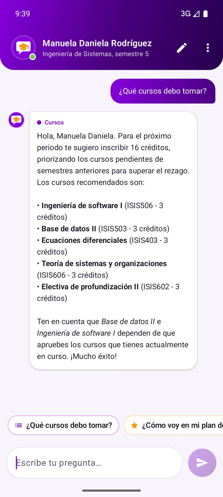 |
| Competencias digitales | ¿Qué competencias digitales me faltan? | 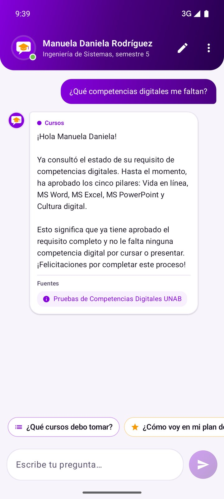 |
| Horas libres | ¿Cuántas horas libres llevo? | 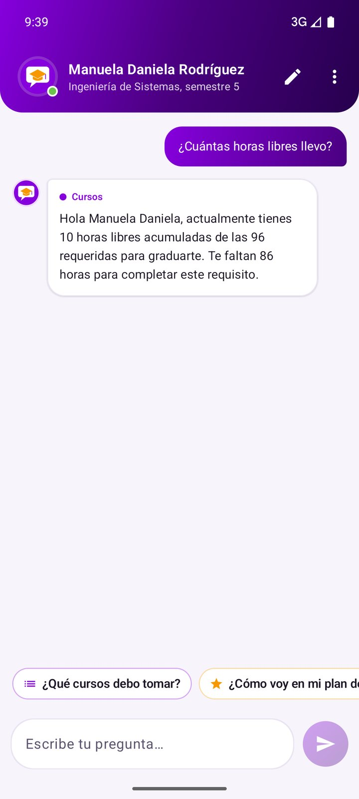 |
| Reglamento y procesos | ¿Cuándo un estudiante queda en prueba académica? ¿Qué es la insignia de competencias digitales? | 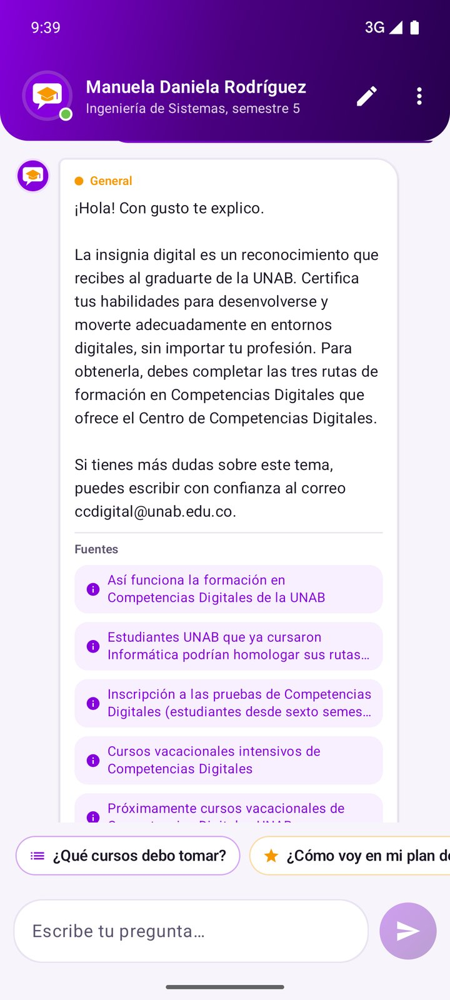 |
| Noticias | ¿Qué noticias de tecnología hay hoy? | 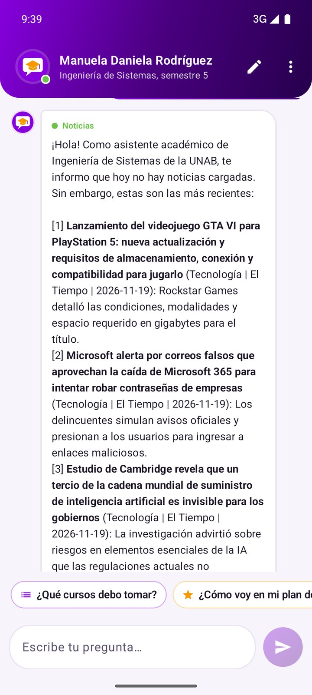 |
| Calendario | ¿Cuándo empiezan las clases? | 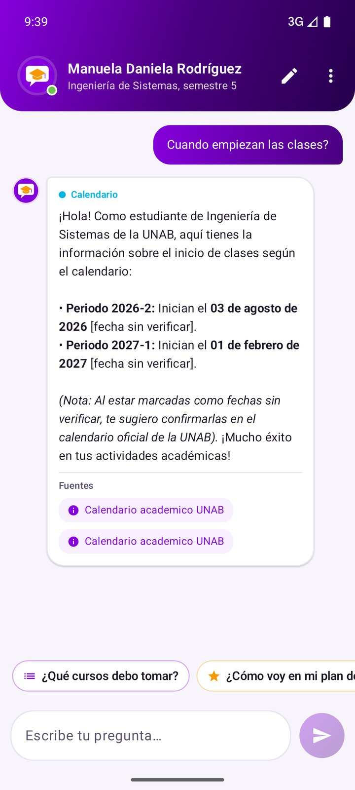 |

Cada respuesta tiene una etiqueta de color con el tema (Matrícula, Cursos, General, Noticias, Calendario) y, si viene de un documento
oficial, la lista de **Fuentes**: toca una para abrirla en el navegador. Debajo del chat quedan atajos con las preguntas frecuentes.

El asistente recuerda la conversación: puedes hacer preguntas de seguimiento ("¿y cuál de esos cursos es el más urgente?").

## 6. Noticias del día

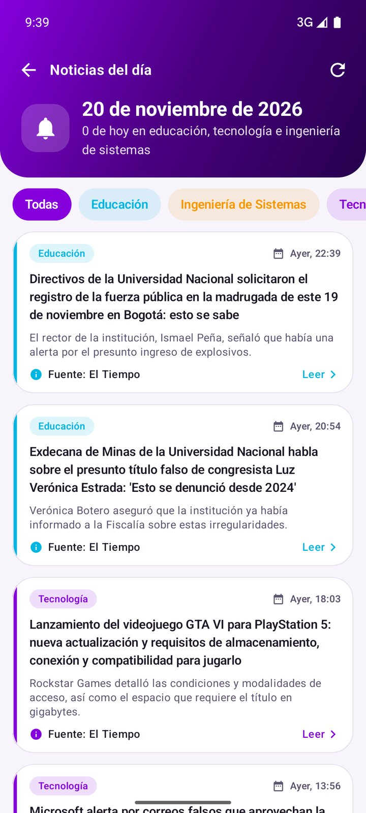 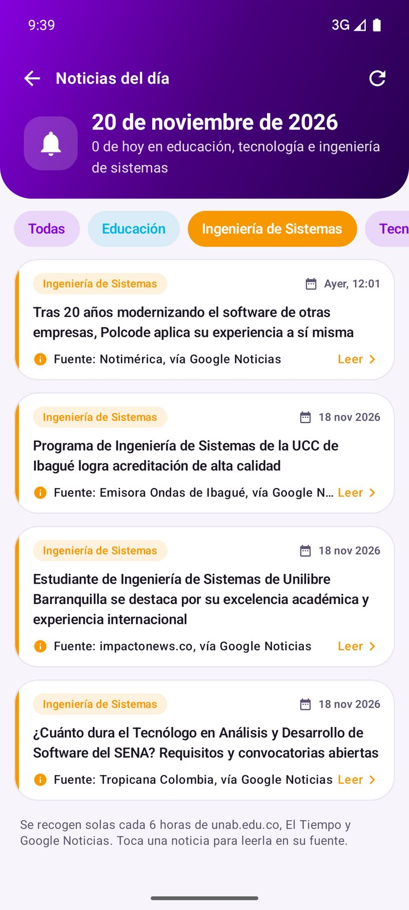

- Arriba, la fecha y cuántas noticias son de hoy.
- Filtra por **Educación**, **Ingeniería de Sistemas**, **Tecnología** o **Vida UNAB**.
- Cada noticia muestra su categoría, la marca **HOY** si es del día, la hora, el titular, un resumen y la **fuente** (por ejemplo El
  Tiempo o UNAB). Tócala para leerla completa en su fuente.
- El botón de actualizar vuelve a pedirlas. Las noticias se recogen solas cada 6 horas.

## 7. Mi perfil y horario

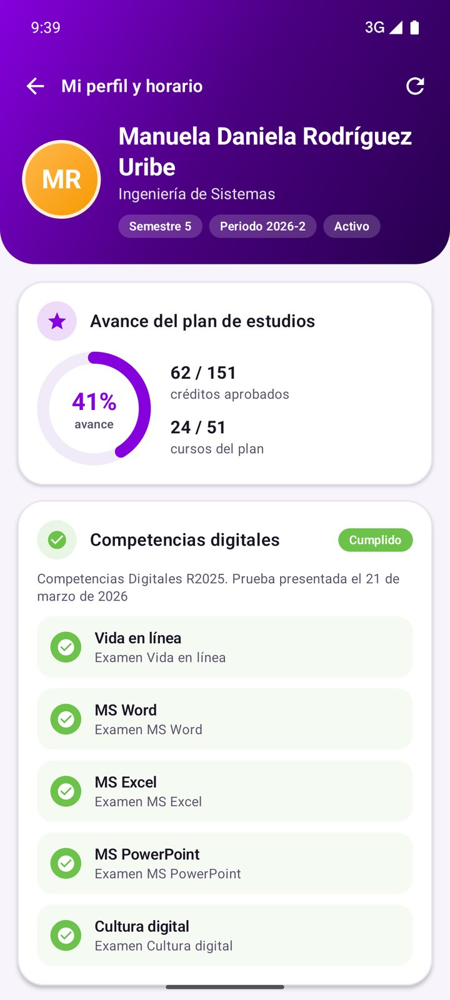 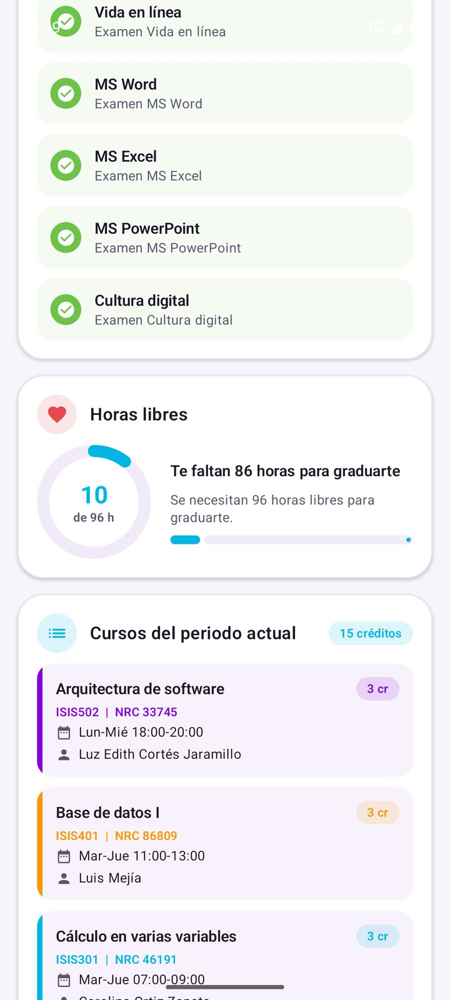 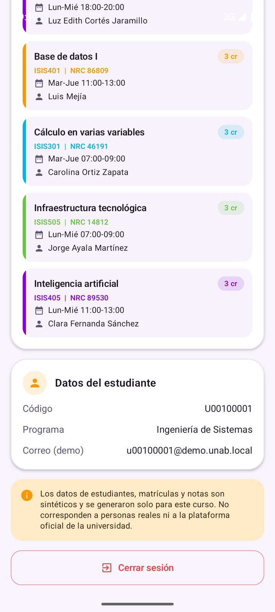

- **Avance del plan**: créditos aprobados frente a los 151 del plan y cursos aprobados.
- **Competencias digitales**: los 5 pilares de la prueba (Vida en línea, MS Word, MS Excel, MS PowerPoint, Cultura digital) con
  aprobado o pendiente; si falta uno, debes inscribir el curso de ese pilar.
- **Horas libres**: horas acumuladas frente a las 96 requeridas para graduarte.
- **Cursos del periodo actual**: NRC, horario y profesor de cada curso.
- **Actualizar** (arriba) vuelve a consultar tus datos; **Cerrar sesión** (abajo) vuelve a la pantalla de ingreso.

## 8. Lo que el asistente no hace

- No muestra información de otros estudiantes: solo la de tu código.
- No pide ni guarda contraseñas o claves.
- No responde temas ajenos a la universidad (deportes, política, tareas): te recuerda en qué puede ayudarte.
- Si no encuentra la respuesta en los documentos oficiales, lo dice y te remite a unab.edu.co.

## 9. Problemas frecuentes

| Mensaje | Qué hacer |
|---|---|
| "El token del chat es incorrecto" | Revisa el token en Ajustes del webhook |
| "Falta la URL del webhook" | Escribe la URL en Ajustes del webhook |
| "No hay conexión con el servidor" | Revisa tu internet |
| "El servidor tardó demasiado" o "No pude generar una respuesta confiable" | Espera unos segundos y reintenta: el servicio de IA tiene un límite de preguntas por minuto |
| La primera respuesta del día tarda más | El servidor de AWS puede estar arrancando; espera uno o dos minutos |
