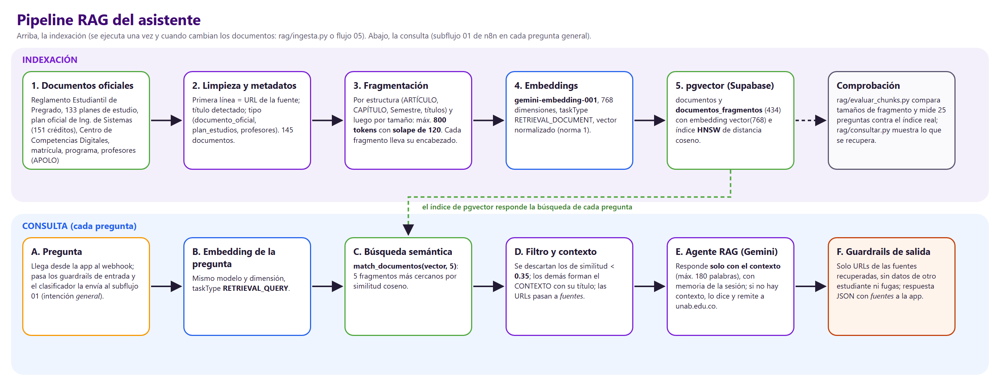
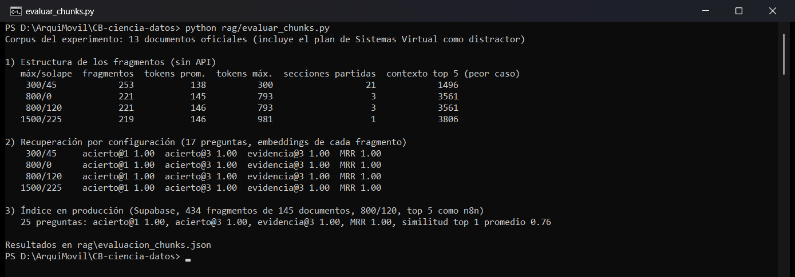
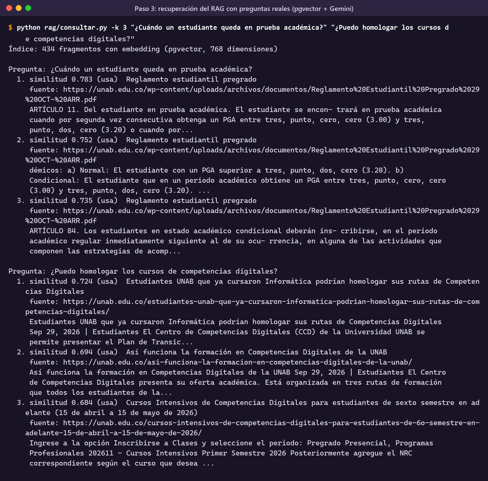
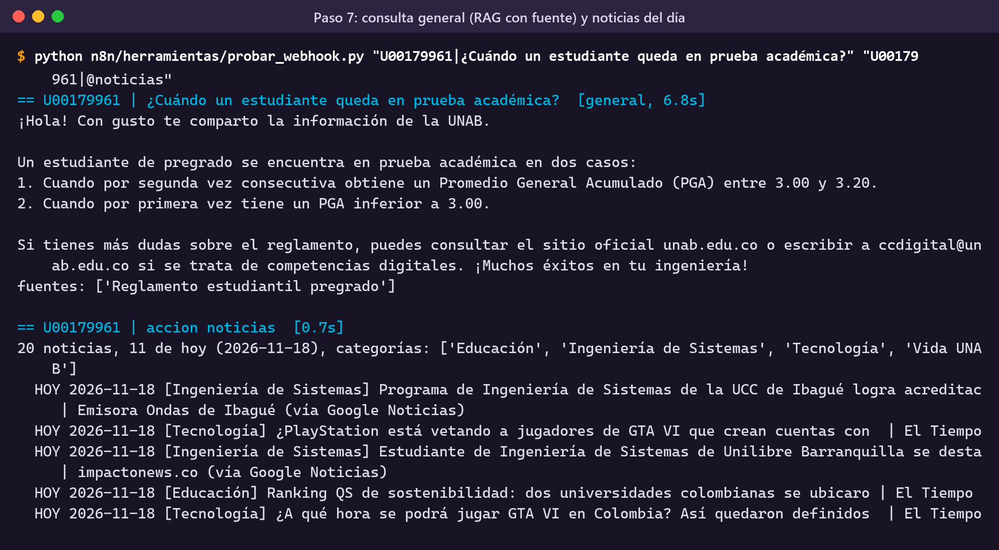

# RAG: documentos, parámetros y justificación

El RAG responde las preguntas generales (reglamento, plan de estudios, requisitos y procesos de la UNAB) solo con información de
documentos oficiales, y devuelve la fuente de cada respuesta. Lo usan el subflujo **01 Consulta general** de n8n y la herramienta MCP
`buscar_documentos`.



## 1. Documentos usados

| Documento | Fuente | Para qué preguntas |
|---|---|---|
| Reglamento Estudiantil de Pregrado | [PDF oficial](https://unab.edu.co/wp-content/uploads/archivos/documentos/Reglamento%20Estudiantil%20Pregrado%2029%20OCT-%20ARR.pdf) | Prueba académica, cancelaciones, reintegro, homologaciones, validaciones, habilitaciones, promedio |
| Plan de estudios de Ingeniería de Sistemas (151 créditos) | [Página del programa](https://unab.edu.co/programas/ingenieria-de-sistemas/) y su documento del plan | Materias por semestre, créditos, práctica |
| Plan usado por el asistente | `db/seed/planes.py` (el mismo plan, con tipo de curso y electivas numeradas) | Igual que el anterior, con los nombres que usa la base |
| Planes de estudio de los 133 programas | Páginas de unab.edu.co | Comparar programas o consultar otro plan |
| Requisitos y cursos del Centro de Competencias Digitales (7 documentos) | Publicaciones de unab.edu.co | Rutas e insignia, pruebas desde sexto semestre, homologación, cursos intensivos y vacacionales, prueba diagnóstica |
| Matrícula de pregrado | [unab.edu.co](https://unab.edu.co/matricula-pregrado-profesional/) | Pasos de matrícula |
| Página del programa | [unab.edu.co](https://unab.edu.co/programas/ingenieria-de-sistemas/) | Título, duración, costos, acreditación |
| Profesores (resumen de APOLO) | apolo.unab.edu.co | Profesores por unidad |

En total: **145 documentos y 434 fragmentos** con embedding en la tabla `documentos_fragmentos`. Los textos están en
`data/oficial/docs/`; la primera línea de cada archivo es la URL de su fuente.

## 2. Pipeline

**Indexación** (`rag/ingesta.py` para el índice de producción; el flujo 05 de n8n es la vía dentro de n8n para agregar o refrescar documentos):
1. Lee cada documento y separa la URL de la fuente y el título.
2. Fragmenta por estructura: cada encabezado (ARTÍCULO, CAPÍTULO, Semestre, títulos) abre una sección, y cada fragmento lleva su
   encabezado para no perder el contexto.
3. Si una sección pasa de **800 tokens**, la parte en trozos con **120 tokens de solape**.
4. Calcula el embedding con `gemini-embedding-001` (768 dimensiones, `taskType: RETRIEVAL_DOCUMENT`) y lo normaliza.
5. Hace upsert del documento (por `fuente_url`) y reemplaza sus fragmentos en `documentos_fragmentos`.

**Dos vías de indexación, con los mismos límites.** Los 145 documentos y 434 fragmentos del índice de producción se construyeron con
`rag/ingesta.py`, que fragmenta **por estructura** (artículos, capítulos, encabezados) con tope de 800 tokens y solape de 120. n8n no tiene
un fragmentador por estructura, así que el flujo 05 usa el nodo *Recursive Character Text Splitter* con `chunkSize` 3200 y
`chunkOverlap` 480 **caracteres**, que equivalen a unos 800 y 120 tokens con unos 4 caracteres por token (aproximación; `ingesta.py`
estima 1.35 tokens por palabra). El flujo 05 también pide los embeddings con `gemini-embedding-001`, 768 dimensiones y
`RETRIEVAL_DOCUMENT`. La diferencia es que parte por tamaño y no por artículo, de modo que un documento agregado desde n8n puede cortar
un artículo por la mitad; para el reglamento y los planes se usó `ingesta.py`.

**Consulta** (subflujo 01 en cada pregunta):
1. Embedding de la pregunta con el mismo modelo (`taskType: RETRIEVAL_QUERY`).
2. `match_documentos(vector, 5)`: los 5 fragmentos más cercanos por similitud coseno (índice HNSW).
3. Descarta los de similitud menor que **0.35**; con los demás arma el CONTEXTO y la lista de fuentes.
4. El agente RAG (Gemini) responde **solo con el contexto**; si no hay contexto, lo dice y remite a unab.edu.co.
5. El guardrail de salida deja solo los enlaces de las fuentes recuperadas.

## 3. Justificación de los parámetros

| Parámetro | Valor | Por qué |
|---|---|---|
| Fragmentación | Por estructura y luego por tamaño | El reglamento está organizado por artículos: un artículo es la unidad natural de una respuesta, y el encabezado le da contexto al fragmento |
| Tamaño máximo | 800 tokens | Con 800, solo 3 secciones necesitan partirse; con 300 serían 21 (artículos cortados por la mitad); con 1500 sería 1, pero los fragmentos pueden llegar a 981 tokens sin mejorar la recuperación |
| Solape | 120 tokens (15 %) | En las 3 secciones que se parten, la idea que cruza el corte queda completa en uno de los dos fragmentos. En el experimento, 800/0 y 800/120 empatan porque casi nada se parte; el solape es un seguro barato para los artículos largos |
| Modelo de embeddings | `gemini-embedding-001` | Multilingüe (los documentos y preguntas son en español), con tipos de tarea distintos para documento y pregunta, disponible en el plan gratuito y en la misma API del LLM |
| Dimensión | 768 | El modelo permite reducirla (por defecto 3072): el índice ocupa la cuarta parte. La recuperación medida es perfecta en las 25 preguntas con 768; **no se comparó contra 3072**, así que "sin pérdida de calidad" se afirma solo para estas pruebas |
| k | 5 | Peor caso de contexto con 800 tokens: 3561 tokens, muy por debajo del límite del modelo; deja espacio para el prompt y la memoria |
| Umbral | 0.35 | Filtro de ruido: descarta fragmentos casi sin relación. **No separa preguntas del dominio de las ajenas**: con 15 preguntas fuera de dominio, todas superaron 0.35 (ver la sección 5). La evidencia respalda un valor cercano a 0.65 |

## 4. Experimento

`rag/evaluar_chunks.py` fragmenta los 13 documentos oficiales principales (incluye a propósito el plan de **Ingeniería de Sistemas
Virtual** como distractor, porque se parece mucho al presencial) con cuatro configuraciones, y evalúa con preguntas típicas de
estudiantes, cada una con su documento correcto y la frase que la responde.

**Estructura de los fragmentos** (sin API):

| Máx./solape | Fragmentos | Tokens promedio | Tokens máximo | Secciones partidas | Contexto top 5 (peor caso) |
|---|---|---|---|---|---|
| 300/45 | 253 | 138 | 300 | 21 | 1496 |
| 800/0 | 221 | 145 | 793 | 3 | 3561 |
| **800/120** | **221** | **146** | **793** | **3** | **3561** |
| 1500/225 | 219 | 146 | 981 | 1 | 3806 |

**Recuperación por configuración** (17 preguntas, embeddings de cada fragmento): las cuatro configuraciones aciertan el documento de
primero y traen la frase que responde en el top 3 en las 17 preguntas (acierto@1 = 1.00, evidencia@3 = 1.00, MRR = 1.00). Como la
calidad es igual, el tamaño se elige por la estructura: 800 es el valor más pequeño que deja casi todos los artículos enteros, y 1500
solo agranda los fragmentos.

Limitación honesta: el experimento **no discrimina** entre las configuraciones (todas empatan en 1.00) y el fragmento promedio mide unos
146 tokens, así que el tope de 800 casi no se ejercita; la elección se apoya en la estructura de los documentos y no en una diferencia de
acierto. El resultado guardado de la comparación de tamaños (`comparacion.preguntas` en `rag/evaluacion_chunks.json`) se calculó con 17
preguntas; el conjunto actual del script tiene 25 y es el que valida el índice de producción. Volver a ejecutar `--comparar` (unas 700
llamadas a la API) recalcularía la comparación con las 25; no se repitió porque las cuatro configuraciones ya empataban.

**Índice en producción** (Supabase, los 434 fragmentos de los 145 documentos, configuración 800/120 y top 5, igual que n8n), con 25
preguntas, 8 de ellas de detalle y con otras palabras que las del documento ("¿Qué promedio necesito para estudiar dos carreras al
tiempo?", "¿Cuánto pesa la prueba de habilitación en la nota definitiva?"):

| Acierto@1 | Acierto@3 | Evidencia@3 | MRR | Similitud top 1 promedio |
|---|---|---|---|---|
| 1.00 | 1.00 | 1.00 | 1.00 | 0.76 |

Las 25 preguntas y sus resultados están en [`rag/evaluacion_chunks.json`](../rag/evaluacion_chunks.json). La similitud top 1 de estas 25
preguntas va de 0.729 a 0.799.



## 5. Umbral de similitud: evidencia medida

Hasta ahora el 0.35 solo se había justificado con las preguntas que sí tienen respuesta. `rag/evaluar_umbral.py` mide también las que no:
embebe 15 preguntas del dominio (reglamento, plan, matrícula, calendario, CCD) y 15 ajenas (deportes, cocina, famosos, trivia de
programación sin relación con la UNAB) con `RETRIEVAL_QUERY` a 768 dimensiones y toma la similitud del fragmento más cercano del índice
real (`match_documentos`). El resultado completo está en [`rag/evaluacion_umbral.json`](../rag/evaluacion_umbral.json).

| Grupo | Preguntas | Mínimo | Promedio | Máximo | Sobre 0.35 |
|---|---|---|---|---|---|
| En el dominio | 15 | 0.705 | 0.765 | 0.799 | 15 |
| Fuera del dominio | 15 | 0.549 | 0.576 | 0.611 | 15 |

Lo que muestra:

- **Con 0.35 no se descarta ninguna de las 30 preguntas.** Incluso "Dame una receta de arepas con queso" recupera con similitud 0.59 un
  fragmento del Reglamento estudiantil (las 15 ajenas terminaron en ese documento). El umbral 0.35 funciona como filtro de ruido contra
  fragmentos sin ninguna relación, no como barrera de tema.
- **La protección contra preguntas ajenas no está en el RAG.** Viene del clasificador de intención (etiqueta `fuera_de_tema`, que
  responde sin llegar al RAG) y de los guardrails de entrada y salida. El prompt del agente RAG ("responde solo con el contexto") es la
  segunda línea de defensa cuando una pregunta ajena llega a este flujo por un error de clasificación.
- **Los dos grupos sí están separados**: el máximo ajeno (0.611) queda por debajo del mínimo del dominio (0.705). Un umbral cercano a
  **0.65** (a mitad de ese hueco, 0.658) separaría los dos grupos en esta muestra.

**Recomendación (no aplicada en el código ni en los flujos):** subir el umbral a 0.65 y conservar el clasificador. Con 0.65 una pregunta
ajena que se cuele hasta el flujo 01 recibiría el mensaje "no tengo esa información" en lugar de una respuesta armada con fragmentos
irrelevantes. La muestra es pequeña (30 preguntas) y las preguntas del dominio más difíciles que se probaron quedaron entre 0.69 y 0.72
("prerrequisitos de Ingeniería de software I", "inscripciones de matrícula"), lo bastante cerca del límite como para validar el nuevo valor
con más preguntas antes de cambiarlo en producción. Mientras tanto el 0.35 queda documentado como lo que es: un filtro de ruido.

## 6. Demostración de la recuperación

`rag/consultar.py` hace lo mismo que el subflujo 01 y muestra los fragmentos recuperados con su similitud y fuente:

```bash
python rag/consultar.py -k 3 "¿Cuándo un estudiante queda en prueba académica?"
```



La misma pregunta por el webhook y por la app responde con el Reglamento Estudiantil y lo cita como fuente:



## 7. Cómo repetirlo

```bash
python rag/ingesta.py --dry-run          # escribe rag/salida_chunks.json para revisar los fragmentos
python rag/ingesta.py                    # embeddings y carga (GEMINI_API_KEY y DATABASE_URL en el .env)
python rag/ingesta.py --solo "plan"      # solo los documentos cuyo título o tipo contenga "plan"
python rag/evaluar_chunks.py             # estructura y evaluación del índice real
python rag/evaluar_chunks.py --comparar  # además recalcula la comparación de tamaños (unas 700 llamadas a la API)
python rag/evaluar_umbral.py             # 30 embeddings con pausa de 4 s; escribe rag/evaluacion_umbral.json
python -m pytest -q rag/tests            # pruebas del fragmentador
```

El plan gratuito de Gemini limita las llamadas por minuto: la ingesta espera 0.7 s entre fragmentos y el experimento usa lotes
pequeños y guarda los embeddings en `rag/.cache_embeddings.json` (ignorado por git) para no recalcularlos.
