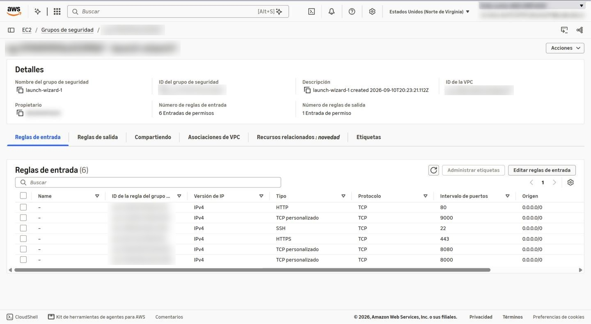

# Security Groups de la instancia EC2 (servidor MCP)

El servidor FastMCP escucha en el **puerto 9000** (HTTP streamable, ruta `/mcp`). La instancia que usó el proyecto es una `t2.large`
**compartida del laboratorio de AWS Academy**, que ya alojaba otros proyectos. La protección real del servidor MCP está en la aplicación
(la clave `X-API-Key`), no en el Security Group, y este documento explica por qué y qué tendría que cambiar en producción.

## Reglas de entrada reales (captura 44)

El Security Group de la instancia (`launch-wizard-1`, creado por el asistente de lanzamiento de AWS) tiene 6 reglas de entrada, todas con
origen `0.0.0.0/0`:

| Puerto | Protocolo | Para qué existe | Quién lo necesita |
|---|---|---|---|
| 9000 | TCP | Servidor MCP de este proyecto (`/mcp`, `/api/*`, `/health`) | n8n Cloud y la app de pruebas |
| 22 | TCP | SSH de administración | Administración de la instancia |
| 80 | TCP | HTTP | Otros proyectos de la instancia compartida |
| 443 | TCP | HTTPS | Otros proyectos de la instancia compartida |
| 8080 | TCP | Servicio de otro proyecto | Otros proyectos de la instancia compartida |
| 8000 | TCP | Servicio de otro proyecto | Otros proyectos de la instancia compartida |



Solo el puerto 9000 pertenece a este proyecto. Los demás los abrieron los otros proyectos que comparten la instancia y este proyecto no
los modificó, porque cerrarlos habría roto esos servicios.

### Por qué el 9000 está abierto a internet

n8n Cloud sale desde direcciones IP que cambian según la región y el plan, y en el plan de prueba no hay una IP de salida fija para
autorizar. Si el puerto 9000 solo admite "My IP", el nodo MCP de n8n responde *Could not connect to your MCP server*. Por eso, en el
laboratorio académico el 9000 se abrió a `0.0.0.0/0` y la protección recae en:

1. **`X-API-Key` obligatorio**: el servidor rechaza con 401 toda petición sin la clave `MCP_API_KEY` (comparación en tiempo constante). La
   única excepción es `GET /health`, que solo devuelve `{"estado":"ok"}`. En n8n la clave es una credencial *Header Auth*.
2. Clave larga y aleatoria (`openssl rand -hex 32`), distinta de `CHAT_TOKEN`.
3. Las herramientas son **consultas** sobre datos **sintéticos**. La única escritura posible es el alta automática de un estudiante
   sintético cuando llega un código válido que no existe (`app/registro.py`); no hay herramientas que borren o modifiquen datos reales.
4. Consultas SQL parametrizadas, validación del código `U00` + 6 dígitos y límites de tamaño en los parámetros.

### Riesgos que quedan

| Riesgo | Efecto | Estado |
|---|---|---|
| El tráfico a 9000 va por HTTP sin cifrar | Quien capture la red entre n8n y la instancia puede leer la `X-API-Key` y las respuestas | Aceptado en el laboratorio: los datos son sintéticos; no es aceptable en producción |
| Cualquiera puede intentar adivinar la clave | Ataque de fuerza bruta contra `X-API-Key` | Mitigado por la longitud de la clave; no hay límite de intentos ni bloqueo por IP |
| SSH (22) abierto a todo internet | Intentos de acceso a la instancia compartida | Protegido solo por la llave `.pem`; no es la configuración recomendada |
| Puertos 80, 443, 8000 y 8080 abiertos | Superficie de otros proyectos en la misma instancia | Fuera del alcance de este proyecto |

### Endurecimiento recomendado para producción

1. **SSH (22)** solo desde la IP propia (`/32`) o, mejor, sin SSH: Session Manager de AWS Systems Manager.
2. **Puerto 9000 no expuesto directamente**: un proxy inverso con TLS (Caddy o Nginx con un dominio y certificado) en el 443, y el 9000 solo
   en `127.0.0.1`. Si se necesita publicar el 9000, restringir el origen a las IP de salida de n8n cuando el plan las publique (n8n
   autoalojado con IP fija, o un plan que las garantice).
3. **Instancia propia por proyecto** (o un Security Group por proyecto), con solo los puertos que ese proyecto usa.
4. Limitar intentos por IP (por ejemplo `fail2ban` o la regla de límite del proxy) y rotar `MCP_API_KEY` si se sospecha que se filtró.
5. Usar `ec2_setup.sh` (que activa `ufw`) solo en una instancia **propia**: en la compartida activaría un firewall que bloquearía los
   puertos de los otros proyectos. En el laboratorio no se usó `ufw`; las dos capas reales son el Security Group y la `X-API-Key`.

## Reglas de salida (Outbound)

| Tipo | Protocolo | Puerto | Destino |
|---|---|---|---|
| Todo el tráfico | Todos | Todos | `0.0.0.0/0` |

Necesario para que el contenedor llegue a Supabase (PostgreSQL, 6543/5432) y a la API de Gemini (443).

## Pasos en la consola de AWS (instancia propia)

En el laboratorio compartido se reutilizó el Security Group existente y solo se agregó la regla del 9000. En una instancia propia:

1. EC2 > Security Groups > *Create security group* (`sg-cb-mcp`), VPC por defecto.
2. Inbound: agregar SSH (22) con origen *My IP* y *Custom TCP* 9000 con origen `0.0.0.0/0` (o las IP de n8n, ver arriba).
3. Outbound: dejar la regla por defecto (todo el tráfico).
4. Al lanzar la instancia (Ubuntu Server 24.04 LTS, 20 GB; el proyecto corrió en una `t2.large` compartida; en una propia habría que elegir el tamaño según la carga, y no se midió el mínimo necesario), asociar este grupo y un par de claves `.pem`.
5. Si su IP doméstica cambia, edite la regla SSH (22) con la nueva IP.

## Verificación

```bash
# Sin clave: debe responder 401/403
curl -i http://IP_PUBLICA:9000/mcp
# Con clave: debe responder (el handshake MCP exige POST JSON-RPC)
curl -i -H "X-API-Key: $MCP_API_KEY" -H "Accept: application/json, text/event-stream" -H "Content-Type: application/json" \
  -d '{"jsonrpc":"2.0","id":1,"method":"initialize","params":{"protocolVersion":"2025-03-26","capabilities":{},"clientInfo":{"name":"prueba","version":"1"}}}' \
  http://IP_PUBLICA:9000/mcp
```

En una instancia propia con las reglas del paso anterior, desde otro puerto (por ejemplo 8080 o 5432) la conexión debe fallar: confirma que solo 22 y 9000 están abiertos. En la instancia compartida esta comprobación no aplica, porque los otros proyectos tienen abiertos 80, 443, 8000 y 8080.
